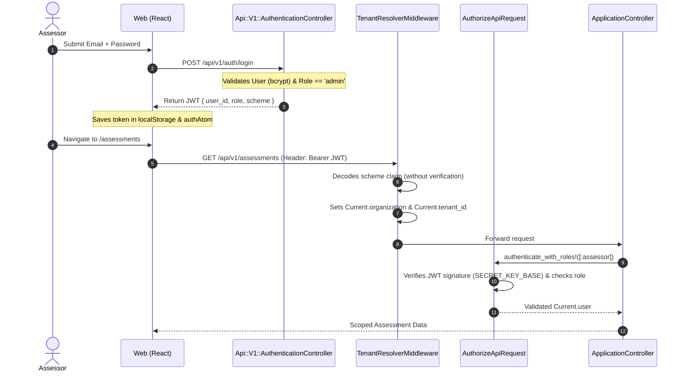
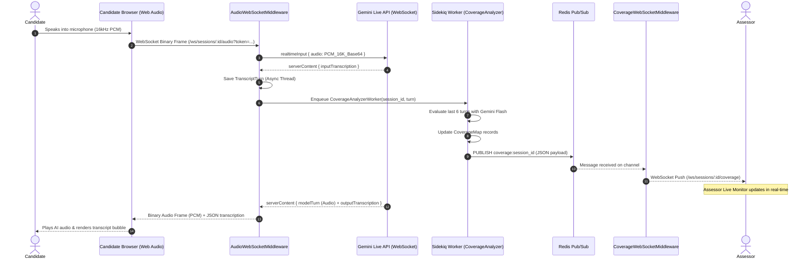

# System Architecture Map

- **Platform:** AI Interview Platform
- **Branch:** `assessment/trustworthy-results`
- **Services:** Rails 7 API (`api/`) & React 18 / Vite SPA (`web/`)

---

## 1. Backend Module Inventory (`api/`)

```
api/app/
├── auth/
│   └── authorize_api_request.rb       # JWT claim parser & role validation (admin, assessor)
├── channels/
│   ├── audio_websocket_middleware.rb   # Bi-directional 16kHz PCM audio proxy to Gemini Live
│   └── coverage_websocket_middleware.rb# Server-push WebSocket for assessor live monitoring
├── clients/
│   └── gemini/
│       ├── live_client.rb             # Faye WebSocket client for Gemini BidiGenerateContent
│       └── http_client.rb             # Faraday REST client for Gemini 2.0 Flash / Pro models
├── controllers/
│   ├── application_controller.rb      # Base controller with tenant & role enforcement
│   ├── concerns/
│   │   ├── exception_handler.rb       # JSON error formatting for rescue_from
│   │   └── response.rb                # json_response and json_error helpers
│   └── api/v1/
│       ├── api_controller.rb          # Base V1 controller (inherits ApplicationController)
│       ├── authentication_controller.rb# Login endpoint (/api/v1/auth/login)
│       ├── assessments_controller.rb  # Assessment CRUD & session creation
│       ├── sessions_controller.rb     # Session lifecycle, coverage, transcript, candidate info
│       ├── portfolios_controller.rb   # Portfolio retrieval, regeneration, fit/gap, export
│       ├── portfolio_skills_controller.rb # Assessor override creation & update
│       ├── vacancies_controller.rb    # Vacancy definition & requirements CRUD
│       └── skill_taxonomies_controller.rb # Read-only B7 taxonomy anchors
├── middlewares/
│   ├── application_middleware.rb      # Base Rack middleware
│   ├── tenant_resolver_middleware.rb  # Resolves Current.organization via JWT scheme/header
│   └── auth_token_middleware.rb       # Auth token extraction
├── models/
│   ├── application_record.rb          # Base ActiveRecord model
│   ├── concerns/
│   │   └── tenant_scoped.rb           # default_scope { where(tenant_id: Current.tenant_id) }
│   ├── organization.rb                # Multi-tenant organization record in public schema
│   ├── user.rb                        # Local user auth model with bcrypt
│   ├── assessment.rb                  # Assessment configuration (skills, time limits, prompt)
│   ├── assessment_skill.rb            # Configured skill with L1-L5 behavioral anchors
│   ├── session.rb                     # Candidate interview instance with invite token
│   ├── coverage_map.rb                # Live skill probe states (not_yet, initiated, partial, covered)
│   ├── transcript_turn.rb             # Sequential candidate & AI speech turn records
│   ├── portfolio.rb                   # Evaluated skill portfolio record
│   ├── portfolio_skill.rb             # Skill-level AI score, confidence, and quote evidence
│   ├── assessor_override.rb           # Human assessor rating override and notes
│   ├── vacancy.rb                     # Target job vacancy requirements
│   ├── vacancy_skill.rb               # Required skill and expected L1-L5 level
│   ├── fit_gap_report.rb              # Matrix comparison and narrative summary
│   └── skill_taxonomy.rb              # Master taxonomy library (22 pilot B7 skills)
├── services/
│   ├── assessments/
│   │   └── system_prompt_compiler.rb  # Compiles dynamic Gemini system prompt from anchors
│   ├── sessions/
│   │   ├── start_handler.rb           # Activates session & initializes coverage map
│   │   └── end_handler.rb             # Terminates session & enqueues portfolio generation
│   ├── coverage/
│   │   ├── analyzer.rb                # Async Gemini Flash analysis of recent 6 turns
│   │   ├── map_injector.rb            # Formats coverage state for realtimeInput injection
│   │   └── state_engine.rb            # State transition rules & gatekeeper
│   ├── portfolios/
│   │   └── generator.rb               # Async Gemini Pro holistic transcript evaluation
│   ├── fit_gap/
│   │   └── engine.rb                  # Delta calculation + Gemini Flash narrative generation
│   └── exports/
│       └── pdf_generator.rb           # Prawn PDF generation for candidate portfolios
└── workers/
    ├── system_prompt_generator_worker.rb # Async compiler on assessment creation
    ├── coverage_analyzer_worker.rb       # Async coverage evaluation on candidate turns
    ├── portfolio_generator_worker.rb     # Async portfolio evaluation on session end
    └── fit_gap_generator_worker.rb       # Async fit/gap report generation on demand
```

---

## 2. Frontend Module Inventory (`web/`)

```
web/src/
├── components/
│   ├── ErrorBoundary.tsx              # React class error boundary
│   ├── HardwareCheck.tsx              # Mic, speaker, camera, latency & speed tests
│   ├── ProtectedRoute.tsx             # Auth guard checking authAtom token
│   ├── StatusIndicator.tsx            # Connectivity and state badges
│   ├── assessment/
│   │   ├── CustomSkillForm.tsx        # Dynamic custom skill & anchor creator
│   │   ├── LevelRadio.tsx             # L1-L5 proficiency selector
│   │   ├── SkillCard.tsx              # Configured skill item display
│   │   └── SkillPicker.tsx            # B7 Taxonomy skill search and selection modal
│   ├── fitgap/
│   │   └── ComparisonTable.tsx        # Fit/Gap comparison table with delta badges
│   ├── interview/
│   │   ├── ConnectionStatus.tsx       # Live WebSocket latency & state pill
│   │   ├── InterviewTimer.tsx         # Countdown timer with time ceiling callbacks
│   │   ├── TranscriptBubble.tsx       # Real-time transcript turn bubble
│   │   └── VoiceBars.tsx              # Audio visualizer for AI / candidate speech
│   ├── layout/
│   │   ├── AssessorLayout.tsx         # Assessor dashboard header and navigation
│   │   └── CandidateLayout.tsx        # Minimal distraction-free candidate container
│   ├── portfolio/
│   │   ├── ConfidenceIndicator.tsx    # High/Med/Low confidence badge
│   │   ├── LevelBadge.tsx             # Visual L1-L5 pill
│   │   ├── OverridePanel.tsx          # Assessor rating adjustment & notes form
│   │   └── SkillPortfolioCard.tsx     # Card with AI level, summary, evidence quotes
│   └── ui/                            # Radix UI + Tailwind design primitives
├── hooks/
│   ├── useAudioCapture.ts             # AudioWorklet (16kHz PCM mono capture)
│   ├── useAudioPlayback.ts            # Web Audio API queue and playback buffer
│   ├── useAudioWebSocket.ts           # Binary & JSON WebSocket client for candidate audio
│   ├── useCoverageWebSocket.ts        # Redis pub/sub WebSocket client for assessor live monitor
│   └── usePolling.ts                  # Interval fetch helper for async jobs
├── pages/
│   ├── assessments/                   # Assessment list, builder, editor, invite generator
│   ├── auth/                          # Login and unrouted Signup page
│   ├── fitgap/                        # Vacancy comparison matrix & narrative report
│   ├── interview/                     # Candidate voice interview room
│   ├── monitor/                       # Assessor live session monitor (coverage & transcript)
│   ├── portfolio/                     # Candidate evaluation portfolio & override view
│   ├── transcript/                    # Full session transcript viewer
│   └── vacancies/                     # Vacancy list, creator, and editor
├── services/                          # Axios API clients
├── stores/                            # Jotai atoms for auth token and tenant context
├── types/                             # Domain TypeScript interfaces
└── utils/                             # Hardware checkers, speed tests, constants
```

---

## 3. Core Architectural Flows

### 3.1 Authentication & Authorization Flow



### 3.2 Live Audio Streaming & Real-time Coverage Flow



---

## 4. End-to-End Candidate Assessment Data Flow

```
[Candidate Voice Input]
       │
       ▼
[AudioWorklet: 16kHz PCM Mono]
       │
       ▼ (WebSocket)
[AudioWebSocketMiddleware]
       ├──► [Gemini Live API: BidiGenerateContent] (Live AI Audio Response)
       │
       ├──► [TranscriptTurn Persistence] (Database: PostgreSQL)
       │
       ▼ (Sidekiq Async Job: coverage queue)
[CoverageAnalyzerWorker] ──► [Gemini Flash REST API]
       │
       ├──► [CoverageMap Persistence] (Database: PostgreSQL)
       │
       └──► [Redis Pub/Sub: coverage:id] ──► [CoverageWebSocketMiddleware] ──► [Assessor LiveMonitorPage]
       │
[Interview Completed: Sessions::EndHandler]
       │
       ▼ (Sidekiq Async Job: portfolio queue)
[PortfolioGeneratorWorker] ──► [Gemini Pro REST API]
       │
       ▼
[Portfolio & PortfolioSkill Persistence] (Database: PostgreSQL)
       │
       ├────────────────────────────────────────────────┐
       ▼                                                ▼
[Assessor Review: PortfolioPage]             [Recruiter Match: FitGapReportPage]
       │                                                │
       ▼ (Assessor Rating Override)                     ▼ (Async FitGapGeneratorWorker)
[AssessorOverride Persistence]               [FitGapReport Persistence]
       │                                                │
       └───────────────────────┬────────────────────────┘
                               ▼
            [Prawn PDF Generator / JSON Export]
                               ▼
        [Final Recruiter / Hiring Manager Decision]
```
