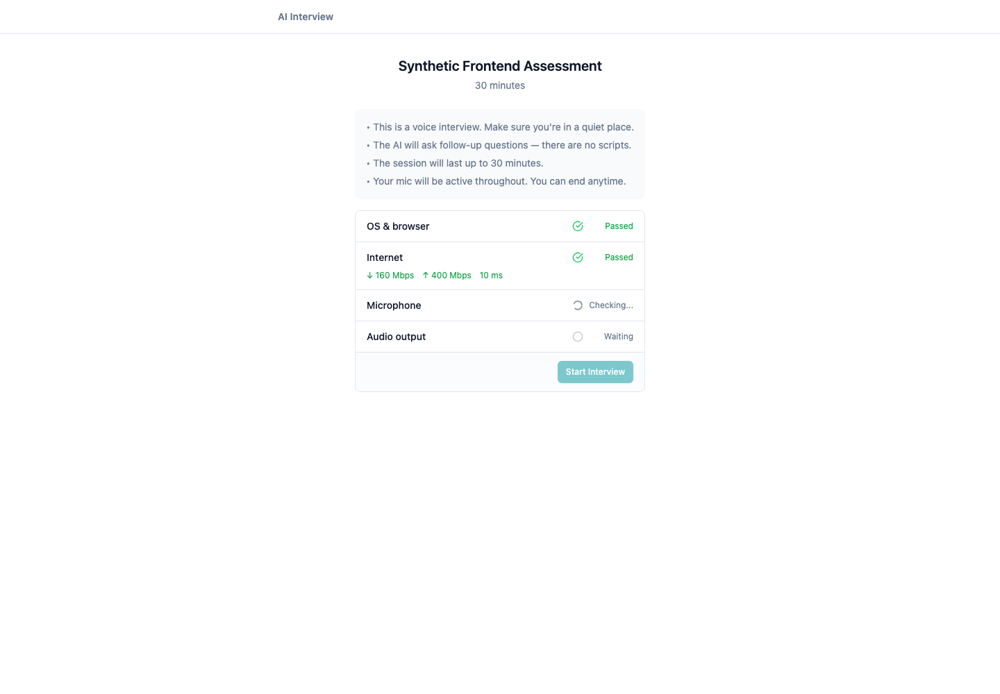
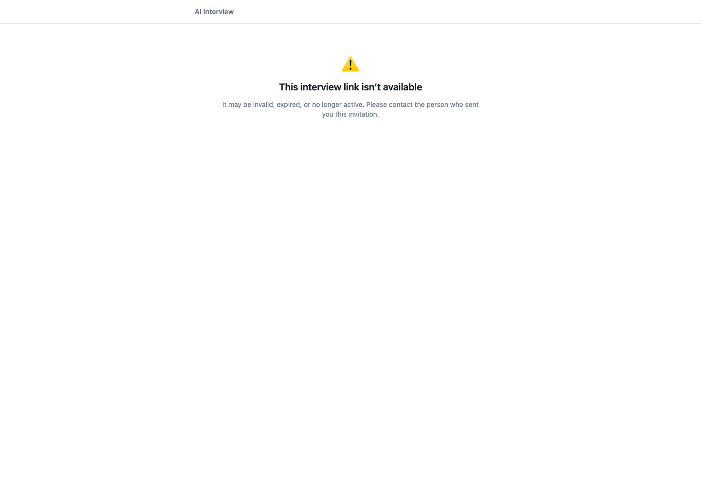

# AI Interview Platform — Case Study Working Notes

This document records the discovery evidence and product decisions that will be
expanded into the final submission report. All local verification used synthetic
development data only.

## 1. Product context

The product helps an assessor define a role-specific skills assessment, invite a
candidate to a live AI-led audio interview, and receive a portfolio of evidence,
ratings, and fit/gap analysis against a vacancy.

The PRD's core promise is not an AI-generated question list. The interview must
adapt to the candidate's answers, collect enough behavioural evidence for each
skill, then support a defensible hiring decision. The end-to-end journey is:

```text
Assessor configures skills
        -> creates candidate invite
        -> candidate opens public interview
        -> live interview produces transcript and coverage
        -> portfolio is generated
        -> assessor reviews fit/gap and exports the result
```

Primary users are assessors, recruiters, and hiring managers. Candidates are
also a first-class affected user: they do not choose the system, but its outcome
can affect their employment opportunity. Interview audio, transcript, name, and
assessed competencies are personal data. This calls for the UU PDP principles
of lawful, transparent, specific and limited processing, and protection against
unauthorised access, disclosure, alteration, misuse, loss, or destruction.

Sources consulted: the repository wiki (PRD 01 and PRD 02) and Indonesia's
UU No. 27 of 2022 on Personal Data Protection.

## 2. Baseline verification

- API, web, PostgreSQL, Redis, and Sidekiq were run locally.
- The web production build completes successfully.
- A synthetic assessment and synthetic candidate session were created through
  the API. The system-prompt background job completed.
- No real candidate data, production secret, or Gemini API key was used.

## 3. Severity-ranked findings

| Severity | Type | Finding | User impact | Evidence |
| --- | --- | --- | --- | --- |
| P0 | Defective implementation | The generated `invite_url` uses `APP_BASE_URL`, which is documented and deployed as the API host. The candidate SPA route exists only on the web host. | A recruiter can share a link that deterministically returns 404. The candidate cannot enter the interview; no evidence or portfolio can be produced. | A local invite returned HTTP 404 at the API host and HTTP 200 at the web host. `Session#invite_url` and `AssessmentInvitePage` both use that API-generated URL. The PRD explicitly starts with the candidate opening the invite link. |
| P1 | Defective implementation | The candidate page converts *any* failure to load public session data into the “Interview Complete” screen. | A candidate with an invalid/expired/unavailable link is falsely told their interview was recorded, instead of being told what happened and what action is safe. | `InterviewPage` catches `getCandidateInfo` failure and sets `interviewState` to `complete`. |
| P2 | Missing quality infrastructure | RSpec is configured but no working harness/specs exist; `bin/rspec` is absent and the configured suite cannot load `spec_helper`. The web app has no test runner or CI. | A regression in a candidate-critical path can ship undetected. | Local baseline verification. |
| P2 | Defective implementation/documentation | Local setup documents conflicting API ports and an obsolete frontend directory. | Setup and reproduction take longer and can create false environment failures. | Root/API/web READMEs and `.env.example`. |
| Constraint signal | Investigate before production change | The default local multi-worker Puma mode accepted a health request but did not complete it; single-worker mode responded correctly. | If reproducible under the deployment topology, the service may fail health checks or appear unavailable. | Reproduced locally; root cause is not yet established, so it is not included in the first feature slice. |

## 4. Chosen problem statement

**An assessor can successfully configure and invite a candidate, yet the product
hands the candidate an API-host URL instead of the web application URL; the
interview cannot begin, so the assessment produces no hiring signal.**

This is the highest-impact, lowest-ambiguity gap because it breaks the first
candidate-facing handoff in the product's critical path.

## 5. Scope hypothesis for the revamp

The candidate invitation boundary will become reliable and truthful:

1. The API will construct public invite URLs from an explicit web application
   origin, never from the API origin.
2. Deployment and local configuration will make the two origins unambiguous.
3. The assessor invite screen will communicate and copy the corrected public
   candidate URL.
4. The candidate landing page will distinguish loading, invalid/unavailable,
   already-completed, and ready-to-start states before asking for microphone
   permission.
5. Automated tests will prove the URL contract and candidate-state behaviour.

No database migration is expected: `invite_token` is already the stable,
unguessable public capability token. The defect is in the configuration and
presentation seam, not in stored session data.

## 6. Assumptions and open constraints

- A separate web origin is intentional: the repository has a Vercel SPA
  rewrite and the API deployment has its own ingress host.
- `WEB_APP_BASE_URL` will be required for invite generation. The old
  `APP_BASE_URL` is not a valid fallback because it has been established as the
  API base URL in this repository.
- Gemini integration cannot be exercised live without a development key. The
  work will test all deterministic code paths and make external-model failures
  explicit rather than masking them.
- The Puma multi-worker observation is recorded for escalation, not silently
  changed as part of this narrowly scoped candidate-invitation revamp.

## 7. Acceptance criteria and edge cases

### Public invite URL contract

1. A session response always exposes a candidate URL using
   `WEB_APP_BASE_URL`, followed by `/interview/:invite_token`.
2. The API origin (`APP_BASE_URL`) is never used to construct a candidate
   invite URL.
3. A configured web origin with or without a trailing slash produces exactly
   one slash before `interview`.
4. The contract applies both when a session is created and when an existing
   session is returned; old pending sessions therefore become usable after a
   configuration correction without a data migration.
5. Local and deployment templates declare the web and API origins separately.

### Candidate landing states

1. While public session metadata is loading, the candidate sees a loading
   state and cannot begin hardware checks or grant microphone permission.
2. A `pending` or `active` session shows the pre-interview readiness flow.
3. An `ended` session clearly says it has already been completed; it must not
   imply that a newly opened invalid link was recorded.
4. An invalid, expired, unavailable, or failed public session shows a neutral
   recovery message asking the candidate to contact the organiser. It must not
   show interview-completion copy and must not expose internal error details.
5. Candidate metadata remains limited to the role title, duration, and status;
   no assessor-only or transcript data is added to the public response.

### Verification criteria

1. Backend tests fail if the API base URL is emitted as an invite URL, if a
   trailing slash is duplicated, or if an existing session serializes a stale
   URL.
2. Frontend tests fail if loading, unavailable, completed, and ready states are
   incorrectly mapped.
3. The web production build, the backend test suite, and manual local checks
   of the invite URL all pass.

## 8. Options evaluated

| Option | Product impact | Cost and failure modes | Decision |
| --- | --- | --- | --- |
| A. Change only the value of `APP_BASE_URL` | Restores links in one deployed environment. | Keeps an ambiguous name and lets future environments regress; does not correct candidate error handling. | Rejected. |
| B. Introduce an explicit `WEB_APP_BASE_URL`, construct the URL server-side, and add truthful candidate landing states. | Fixes the broken handoff across environments and gives affected candidates an honest recovery path. | Small configuration and UI surface; requires tests and deployment documentation. | **Chosen.** |
| C. Serve the frontend SPA from Rails/the API host. | Makes one origin possible. | Broad deployment, caching, security-header, and release-process change; couples independently deployed services for a single URL bug. | Rejected. |

Option B preserves the existing capability-token model and avoids a data
migration. It is reversible: reverting the environment variable and helper
changes restores the prior contract, although that prior contract is known to
be defective.

## 9. Implementation and verification evidence

### Shipped slice

- `Session#invite_url` now uses `WEB_APP_BASE_URL` and normalizes trailing
  slashes.
- The environment template, Kubernetes config map, and API setup guide now
  distinguish the public web origin from the API origin.
- Candidate landing UI now has explicit loading, ready, already-completed, and
  unavailable states. It does not request microphone access before public
  session metadata is ready.
- RSpec now has a working `spec_helper` and model tests for the URL contract.
- The Vite project now has Vitest and a unit test for candidate access-state
  mapping.

### Test evidence

| Check | Result |
| --- | --- |
| RSpec invite URL contract | 2 examples, 0 failures |
| Vitest candidate access-state mapping | 3 tests, 0 failures |
| Web production build | Passed |
| Existing synthetic session after API restart | Returned a `localhost:5173/interview/...` URL; the frontend route returned HTTP 200; public metadata remained minimal. |

### Visual evidence

Both images below use only synthetic local data. The token itself is omitted
from the screenshots.

| Valid pending session | Invalid or unavailable session |
| --- | --- |
|  |  |

The first image demonstrates that the repaired server-generated URL reaches
the intended SPA and loads the pre-interview readiness screen. The second
demonstrates the separate recovery state introduced for an unavailable token;
it does not claim that an interview has been completed.

### Seeded-fault test

The dedicated branch `scratch/seeded-invite-url-fault` records the required
proof without contaminating the feature branch:

1. Commit `f401e21` deliberately switched invite generation back to the API
   origin.
2. The session URL spec failed twice: once for the wrong origin and once for
   the wrong path.
3. Commit `7274bc6` reverted that seeded defect.

### AI verification note

An initial AI-proposed assertion checked that the full URL did not contain
`//interview`. It produced a false positive because every valid `https://`
URL contains that character sequence before its host. The assertion was
verified against the actual URL grammar and replaced with a `URI` path
assertion. This is why the final test verifies `/candidate/interview/:token`,
not a fragile substring of the serialized URL.
