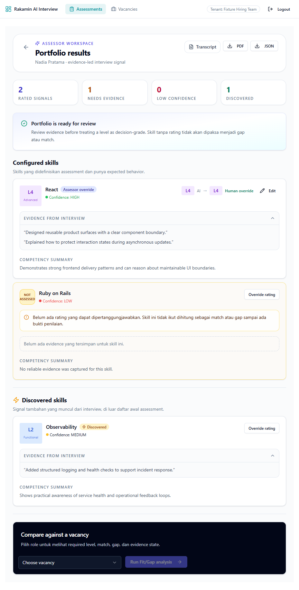
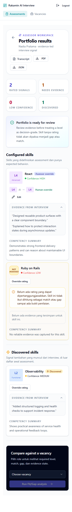
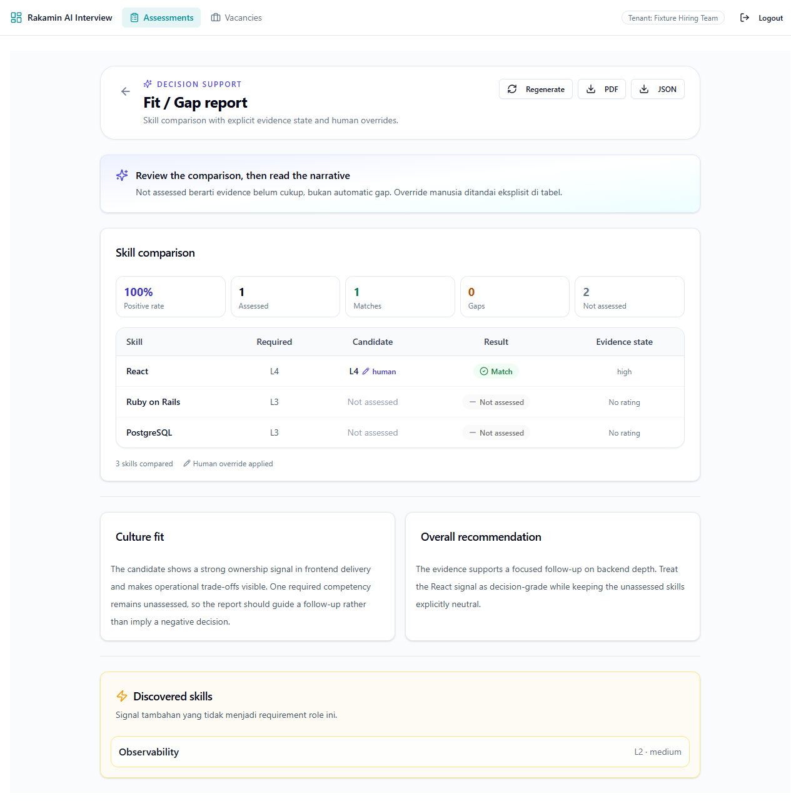
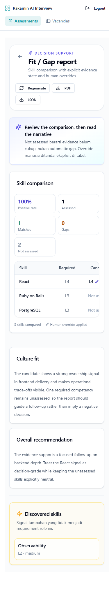
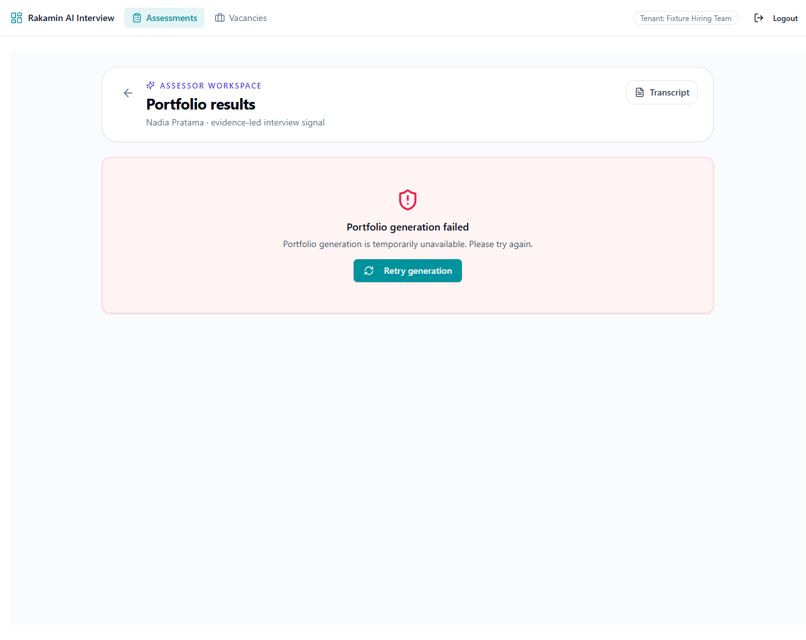
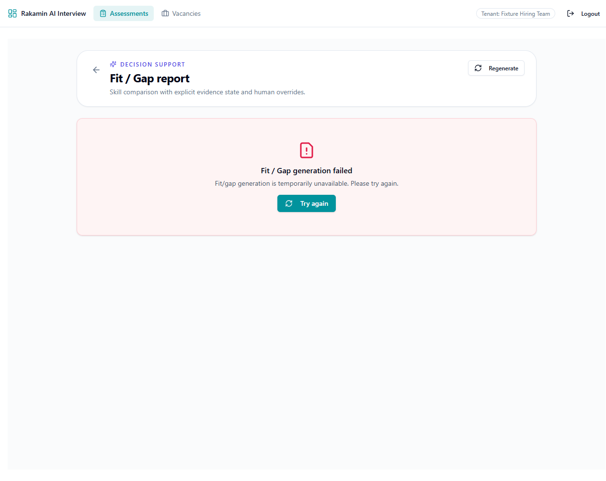

# Assessment Review Revamp

## Submission status

- Repository: `github.com/rakamindev/ai-interview-platform`
- Branch: `feat/assessment-review-revamp`
- Base: `main`
- Verification date: 18 August 2026, 14:21 WIB
- Submission mode: Option A, one comprehensive pull request
- Pull request link: https://github.com/rakamindev/ai-interview-platform/pull/43
- External video link: https://drive.google.com/file/d/1B5ORotRxn2UXJpe4hSTUHfNw1W_o_Epv/view?usp=sharing
- Local video artifact: [`assessment-review-walkthrough.mp4`](../output/video/assessment-review-walkthrough.mp4)

This report documents the complete implementation and verification record. The brief names an existing repository and asks for a pull request against it, so a new standalone repository was not created. The branch was published to a contributor fork, an open draft pull request was created against the upstream repository, and the walkthrough video was uploaded to Google Drive.

## Executive summary

The product helps assessors turn an AI-assisted interview into a candidate portfolio and a vacancy-specific Fit/Gap report. The baseline made an unsafe assumption at the seam between model output, database state, and review UI: missing or malformed evidence could be treated as a rating. That creates false certainty for assessors and can turn an incomplete interview into an unjustified hiring signal.

The revamp makes uncertainty explicit and reviewable. Portfolio skills can be `rated` or `not_assessed`; Fit/Gap comparisons preserve a neutral state when evidence is missing; assessor overrides are visible; asynchronous generation has persisted states and stale-worker protection; tenant access is enforced at the resource boundary; and the frontend covers ready, loading, empty, failed, not-assessed, low-confidence, long-text, and responsive states.

The implementation is verified locally with backend RSpec, frontend tests, a production build, Docker-backed service smoke tests, a real Gemini Live smoke test, browser snapshots, responsive screenshots, failure-state screenshots, and a seeded-fault red-green run.

## Step 1 - Setup and local exploration

### Repository and baseline

The brief identifies `github.com/rakamindev/ai-interview-platform` as the repository. The repository contains:

- `api/`: Rails 7, PostgreSQL, Redis/Sidekiq, RSpec, and Gemini clients.
- `web/`: React 18, TypeScript, Vite, Tailwind, Radix UI, and Jotai.

The starting baseline had no backend specs, no frontend test runner, and no CI workflow. The branch was created from `main`, and the implementation remained isolated on `feat/assessment-review-revamp`.

### Local workflow exercised

1. Read the repository README files and the existing API/frontend flow.
2. Installed and verified Ruby 3.3.2 and Bundler 2.5.11.
3. Started PostgreSQL and Redis through Docker using project-local ports.
4. Migrated the test schema and verified all migrations are up.
5. Ran the assessor review flow against a synthetic local fixture through the real Vite frontend.
6. Exercised portfolio ready, Fit/Gap ready, portfolio failure, Fit/Gap failure, mobile layout, keyboard focus, and browser console states.
7. Ran the API service smoke, Fit/Gap smoke, portfolio smoke, and Gemini Live smoke in the final Docker image.

### Verification commands and results

| Check | Result | Evidence |
| --- | --- | --- |
| Backend service specs | Passed | `13 examples, 0 failures` |
| Frontend unit tests | Passed | `2 tests, 0 failures` |
| Frontend production build | Passed | TypeScript and Vite exited 0 |
| CI workflow syntax | Passed | Ruby YAML parser returned `CI_YAML_OK` |
| Ruby syntax | Passed | 87 Ruby files, 0 syntax failures |
| Docker API health | Passed | HTTP 200 from health endpoints |
| PostgreSQL and Redis | Passed | Containers healthy on local mapped ports |
| Gemini Live | Passed in Docker Linux | Audio chunks received, zero runtime errors |
| Browser console | Passed | Zero error-level messages in local flow |
| Git whitespace | Passed | `git diff --check` clean |

The browser fixture uses synthetic data only. It does not represent a production candidate or a real user account.

## Step 2 - Deep context and domain immersion

### The product

The product exists to help a hiring team move from an interview transcript to a defensible next step. The useful output is not an AI score by itself. It is a reviewable chain of evidence: what was discussed, how reliable the signal is, what remains unknown, how it compares with a vacancy, and where a human assessor changed the interpretation.

### The industry context

Hiring assessment has an asymmetric harm profile. A false positive consumes team time and can create a bad hire. A false negative can remove a candidate from consideration based on a missing probe rather than a lack of ability. In an Indonesian hiring workflow, speed matters, but speed cannot justify turning incomplete evidence into a definitive candidate judgment.

The product therefore treats AI as decision support. It should accelerate evidence review, not remove the assessor's responsibility or hide uncertainty from the people affected by the outcome.

### The users

- Assessors need to review evidence, inspect confidence, record an override, and understand what still needs a follow-up probe.
- Recruiters need a consistent comparison between candidate signals and vacancy requirements without interpreting raw model output.
- Hiring managers need a compact recommendation that exposes important gaps and unknowns instead of presenting a false precision score.
- Candidates are assessed by the system without choosing it. Their transcript, identity, and evaluation can affect a real employment decision, so the interface must avoid overclaiming and the backend must limit access.

### UU PDP implications

This implementation treats candidate identity, transcript-derived evidence, and assessment output as protected data. The relevant official reference is [Undang-Undang Nomor 27 Tahun 2022 tentang Pelindungan Data Pribadi](https://jdih.komdigi.go.id/produk_hukum/view/id/832/t/undangundang%2Bnomor%2B27%2Btahun%2B2022).

The engineering implications are:

- Limit data to the assessment workflow and do not put raw candidate data in logs or fixtures.
- Enforce tenant-scoped access on portfolio, session, vacancy, and override endpoints.
- Avoid leaking raw provider exceptions to the browser or logs.
- Preserve an auditable distinction between AI output and assessor override.
- Do not infer a negative candidate signal from an unassessed skill.
- Keep API keys in runtime environment configuration only; never commit or embed them in frontend artifacts.

### Working assumptions

- AI output is advisory and requires assessor review.
- `not_assessed` is a neutral evidence state, not a hidden low rating.
- An assessor override is an explicit human decision and must remain attributable.
- A failed generation must not expose a partial report as if it were complete.
- A missing vacancy skill match is a data-quality or configuration issue to surface, not a reason to fabricate a comparison.

## Step 3 - Problem and gap analysis

### Severity-ranked findings

| Severity | Finding | Classification | Workflow impact |
| --- | --- | --- | --- |
| P0 | Missing or invalid model ratings could be represented as a usable level. | Defective implementation | An assessor could treat incomplete evidence as a candidate capability signal and make a consequential decision on false certainty. |
| P0 | Assessor-facing resources needed an explicit tenant boundary at the controller seam. | Defective implementation | A mismatched resource identifier could expose another tenant's candidate or vacancy context. |
| P1 | Fit/Gap matching did not have a stable neutral state for missing candidate evidence. | Missing specification plus defective seam | A missing probe could appear as a gap or match, distorting recruiter and hiring-manager decisions. |
| P1 | Generation jobs and polling needed persisted state, lock windows, and stale-worker protection. | Defective implementation | Duplicate jobs could waste provider quota, and a late worker could overwrite a newer result. |
| P1 | Portfolio persistence needed an all-or-nothing boundary around skill replacement. | Defective implementation | A model error during a batch could leave a partial portfolio that looked complete. |
| P2 | The review UI did not define a complete state model for loading, failure, empty, partial, low confidence, and long text. | Missing specification | Assessors could see blank or ambiguous screens and lose the context needed to act safely. |
| P2 | Human overrides needed explicit provenance in both portfolio and Fit/Gap views. | Missing specification | A reviewer could not distinguish model evidence from an assessor decision. |
| P3 | The project had no automated harness or CI baseline. | Missing capability | Regressions in parsing, comparison, or the frontend seam could reach review without a repeatable check. |

### Gap to ideal condition

The ideal condition is a review flow where every displayed conclusion has a visible evidence state, every unknown stays unknown, every write has a tenant and generation boundary, and every important failure has a recoverable user path. The change crosses the API/data model seam and the frontend presentation seam because fixing only one side would either compute a safe state that the UI hides or display a safe state that the backend cannot guarantee.

### Constraint signal

The main constraints escalated during implementation were:

- The shared PostgreSQL schema requires backward-compatible migrations and safe handling of existing rows.
- Gemini model availability changes over time. The initial stale model defaults were rejected by the current catalog/API and had to be corrected.
- Gemini Pro quota for the supplied account was zero, so the final provider smoke used a supported Flash model for deterministic service validation.
- Ruby EventMachine on native Windows did not provide TLS for the Live client. The Docker Linux image did, so Live verification was completed there.
- Direct upstream write access was unavailable, so remote publication used the contributor fork `michaellesmana/ai-interview-platform` and the cross-repository PR linked above.

## Step 4 - Revamp strategy, acceptance criteria, and trade-offs

### Options considered

| Option | Product impact | Cost and maintainability | Failure modes | Decision |
| --- | --- | --- | --- | --- |
| A. Keep asynchronous generation with persisted states, polling, locks, and tokens | Preserves responsive review and makes uncertainty visible without blocking the browser | Small schema change and focused service/UI changes; easy to evolve and roll back | Needs stale-job handling and polling discipline | Chosen |
| B. Make portfolio and Fit/Gap generation synchronous | Simple request flow for small reports | Poor user experience for long model calls; request timeouts and provider latency become user-facing; harder to retry safely | Timeout leaves ambiguous state and encourages duplicate requests | Rejected |
| C. Move all progress to push events | Rich live updates and less polling | Requires stronger WebSocket lifecycle, reconnect, replay, and observability guarantees across API and frontend | Lost events or reconnects can desynchronize the screen from persisted state | Deferred |

Option A fits the current codebase and deadline because it improves the correctness boundary without introducing a new distributed event contract. The API remains the source of truth; the frontend polls the same report and does not enqueue a new job on every 404 or refresh.

### Self-defined acceptance criteria

| ID | Input or edge case | Correct behavior | Verification |
| --- | --- | --- | --- |
| AC-01 | Configured skill omitted by model | Persist it as `not_assessed`, with neutral evidence and no fabricated rating | RSpec and seeded fault |
| AC-02 | Model level is 0, 6, a non-numeric string, or absent | Treat it as invalid and keep the skill `not_assessed` | RSpec |
| AC-03 | Evidence contains non-strings, more than three quotes, or long quotes | Ignore non-strings, keep at most three quotes, and cap each at 500 characters | RSpec |
| AC-04 | Summary is long | Cap the summary at 2,000 characters | RSpec |
| AC-05 | Malformed JSON or malformed collections | Fail before persistence with a safe service error | RSpec and service smoke |
| AC-06 | Discovered skills use duplicate labels with whitespace/case differences | Keep one normalized discovered skill | RSpec |
| AC-07 | Candidate evidence is unassessed in Fit/Gap | Candidate level and delta are null; result is `not_assessed` | RSpec, frontend test, browser screenshot |
| AC-08 | Assessor override exists | Keep override provenance visible and use the effective human level | RSpec, browser screenshot |
| AC-09 | Model call fails | Persist failed state and expose a safe retry path without raw exception details | Docker service smoke, browser screenshot |
| AC-10 | Two jobs target the same report or portfolio | A fresh generation is not duplicated; a stale worker cannot overwrite a newer token | Worker RSpec |
| AC-11 | A batch persistence operation fails | The lock-backed transaction does not expose a partial complete result | Generator transaction boundary and failure-path review |
| AC-12 | Tenant does not own a resource | The API does not return the resource or schedule a job for it | Tenant access review |
| AC-13 | Long text and narrow viewport | Content remains readable without horizontal header clipping | Browser responsive screenshots |
| AC-14 | Loading, empty, failed, and ready states | Each state has an explicit message and a recoverable action where appropriate | Browser snapshots and screenshots |

## Step 5 - Monozukuri implementation and execution proof

### Backend and data model

- `Portfolios::ResultNormalizer` validates model shape, normalizes levels, bounds evidence and summaries, preserves configured skills, and deduplicates discovered labels.
- `Portfolios::Generator` uses a generation token, lock window, safe failure state, and lock-backed persistence.
- `FitGap::Comparator` normalizes labels, preserves required-level semantics, marks not-assessed comparisons, and records override provenance.
- `FitGap::Engine` builds narratives from explicit comparison groups and refuses to publish a stale token result.
- `FitGapGeneratorWorker` prevents duplicate fresh work and stale-worker overwrites.
- `TenantResourceAccess` scopes assessor resources to the current tenant.
- Migrations add rating and generation state backward-compatibly, backfill existing rows, add database checks, and provide reversible `down` paths.

### Frontend

- `PortfolioPage` presents summary metrics, configured/discovered skill sections, explicit not-assessed state, safe generation failure, retry, export, and Fit/Gap navigation.
- `FitGapReportPage` presents required/candidate levels, match/gap/not-assessed result, confidence, override provenance, narratives, generation states, retry, and export errors.
- `SkillPortfolioCard` keeps evidence and competency summaries readable and bounded.
- `ComparisonTable` uses non-color labels and icons for result states.
- `AssessorLayout` was corrected after browser review found header clipping at 390px. Navigation now moves to a second row on narrow screens while logout remains reachable.

### Automated test harness

The current backend suite contains 13 examples covering:

- Missing configured ratings.
- Invalid model levels.
- Numeric string levels.
- Malformed JSON and malformed collections.
- Evidence and summary bounds.
- Discovered label normalization.
- Required-level contract.
- Neutral Fit/Gap comparisons.
- Assessor override provenance.
- Duplicate-job lock behavior.
- Stale generation claims.
- Old-worker failure protection.

The frontend suite contains two deterministic Fit/Gap decision tests. The repository now includes `.github/workflows/ci.yml` to run backend specs, frontend tests, and the production build on pushes and pull requests.

### Seeded fault test

The full red-green evidence is recorded in [`seeded-fault-evidence.md`](./seeded-fault-evidence.md).

- Scratch branch: `evidence/seeded-fault-portfolio-normalizer`
- Fault commit: `46abd90`
- Red run: `5 examples, 2 failures`
- Revert commit: `f6d8aca`
- Green run after revert: `5 examples, 0 failures`

The fault changed the safe fallback from `not_assessed` to `rated`. The tests caught the regression in both the missing-rating and invalid-level cases. The feature branch contains the corrected implementation only.

### AI verification moment

An initial AI-generated configuration preserved stale Gemini model names. Direct model catalog and REST checks showed that the old defaults were unavailable to the account, including a 404 for the legacy Flash model and no current catalog entry for the old 2.x names. I did not trust the generated configuration. I updated the defaults and sample configuration to the supported current runtime models, then repeated the final Docker service smoke and Gemini Live smoke. The supplied API key was used transiently in the runtime environment and was not written to the repository, report, screenshot, fixture, or video.

### Visual evidence

The screenshots were captured from the local Vite app with synthetic fixture data and then inspected as PNGs:

The browser accessibility snapshot confirmed named navigation links, labelled back links, labelled buttons, a `Portfolio summary` region, configured/discovered skill headings, and a `role=alert` failure surface. A keyboard Tab check reached the page's named interactive controls, and the final local browser run reported zero error-level console messages.

### Video artifact

The local walkthrough is 4 minutes 15 seconds, 1280x720 H.264 with narrated audio. It follows the portfolio ready state, mobile layout, Fit/Gap comparison, and both designed failure paths:

[`assessment-review-walkthrough.mp4`](../output/video/assessment-review-walkthrough.mp4)

The walkthrough is hosted externally at [Google Drive](https://drive.google.com/file/d/1B5ORotRxn2UXJpe4hSTUHfNw1W_o_Epv/view?usp=sharing) for reviewer access before the final hiring-portal submission.

## Security and protected data review

The reviewed trust boundaries are browser input, JWT and tenant context, REST controllers, database records, Sidekiq jobs, Gemini responses, exports, and frontend rendering.

- Assessor endpoints use auth and tenant-scoped resource access.
- Vacancy and portfolio lookups are checked against the current tenant before scheduling or reading reports.
- Model responses are shape-checked before persistence.
- Raw provider exceptions are not returned as user-facing generation errors.
- Generation tokens prevent stale work from overwriting a newer result.
- No API key or supplied secret appears in `HEAD`; an exact repository check returned zero matches.
- Synthetic fixture data is used for screenshots and video.
- Existing comments were preserved; no new code comments were added to the implementation changes.

Remaining production review items are secret rotation after any accidental exposure outside the repository, formal retention/deletion policy for transcripts, and a production deployment review of CORS, rate limiting, and logging sinks.

## Step 6 - Final submission readiness

### Complete locally

- Full-stack implementation.
- Reversible data migrations.
- Backend and frontend automated tests.
- CI workflow source.
- Seeded-fault red-green evidence.
- AI verification moment.
- Responsive and failure-state screenshots.
- Four-minute-plus local walkthrough artifact.
- Updated report source and generated PDF.

### Remote publication completed

- Pushed `feat/assessment-review-revamp` to the contributor fork `michaellesmana/ai-interview-platform`.
- Opened the single comprehensive draft pull request at https://github.com/rakamindev/ai-interview-platform/pull/43.
- Uploaded the walkthrough to Google Drive and linked it above.
- Replaced the pending PR and video placeholders with the verified URLs.

The pull request remains open as a draft for review. No merge or production deployment was performed.
