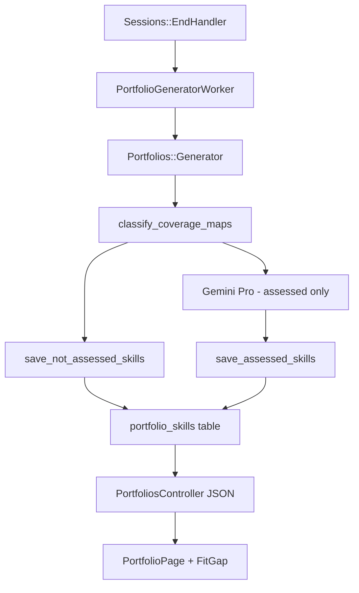

# Honest Skill Verdict

Technical reference for the feature I shipped on branch `feature/honest-skill-verdict`. Written for my own interview prep and for reviewers who want the implementation story without reading every diff.

## Problem

The platform turns live interviews into hiring decisions. Assessors open the portfolio after a session and compare skills against a vacancy. That only works if levels mean something.

Before this change, `Portfolios::Generator` asked Gemini to rate **every** skill on the coverage map, including skills the interview never reached (`not_yet`). Worse, `save_skills` used:

```ruby
ai_level: skill_data['level'].to_i.clamp(1, 5)
```

Missing `level` became **L1**. A candidate who never discussed React could show up as L1 React — indistinguishable from someone who discussed it and was weak.

Fit-gap already had a `not_assessed` result in `FitGap::Engine`, but it almost never fired because every configured skill got a numeric level. The UI also read `required_level` while the API sent `expected_level`, so the Required column was blank.

For assessors in Indonesia deciding whether someone gets a role, that is not a cosmetic bug. Under UU PDP, a wrong automated score is still personal data used in a decision that affects a real person.

## Solution overview

**Deterministic pre-pass** before any Gemini call:

| Coverage state | probe_count | Verdict |
|----------------|-------------|---------|
| `not_yet` | any | `not_assessed` — no Gemini, `ai_level` null |
| `initiated` | &lt; 2 | `not_assessed` |
| `initiated` | ≥ 2 | `assessed` — Gemini scores |
| `partial`, `covered` | any | `assessed` |

Skills marked `not_assessed` are persisted immediately with a fixed summary (`Not discussed in this session.`). Gemini only sees skills with enough coverage.

## Architecture



### Data model (`portfolio_skills`)

Migration `20260816000000_add_honest_assessment_to_portfolio_skills`:

- `assessment_status` enum: `assessed` | `not_assessed` (existing rows backfill `assessed`)
- `ai_level`, `ai_confidence` nullable
- `coverage_state`, `probe_count` denormalized from coverage maps for the results UI
- Check constraint: `ai_level IS NULL OR (ai_level BETWEEN 1 AND 5)`
- Down migration: null levels → 1, drop new columns (safe on existing data)

### Backend files

| File | Role |
|------|------|
| `api/app/services/portfolios/generator.rb` | Pre-pass, selective Gemini prompt, strict level validation |
| `api/app/models/portfolio_skill.rb` | Validations for assessed vs not_assessed |
| `api/app/services/fit_gap/engine.rb` | Nil-safe `not_assessed`, `expected_level` + `is_override` in JSON |
| `api/app/controllers/api/v1/portfolios_controller.rb` | `session_verdict` summary in portfolio JSON |
| `api/app/services/exports/pdf_generator.rb` | PDF shows "Not assessed" instead of fake L1 |

### API: portfolio payload

New fields on each skill:

```json
{
  "assessment_status": "not_assessed",
  "ai_level": null,
  "ai_confidence": null,
  "coverage_state": "not_yet",
  "probe_count": 0
}
```

New `session_verdict` on portfolio:

```json
{
  "end_reason": "time_ceiling",
  "duration_seconds": 540,
  "assessed_count": 4,
  "not_assessed_count": 2,
  "low_confidence_count": 1
}
```

### Frontend

| File | Change |
|------|--------|
| `PortfolioPage.tsx` | Verdict strip, assessed / not assessed sections, error states |
| `VerdictStrip.tsx` | End reason, duration, counts |
| `SkillPortfolioCard.tsx` | Em dash for not assessed, clamp long text |
| `ComparisonTable.tsx` | `expected_level`, not_assessed summary count |
| `InterviewPage.tsx` | Invalid token → error screen (not "Interview Complete") |
| `OverridePanel.tsx` | "Assign rating" for not assessed; override still allowed |

Typography: Fraunces for verdict headlines, Source Sans 3 for UI (Google Fonts in `index.html`).

## Edge cases I handled

1. **All skills not assessed** — no Gemini call; portfolio completes with only `not_assessed` rows.
2. **Gemini timeout / bad JSON** — portfolio `generation_status: failed`, error stored; UI retry via existing regenerate endpoint.
3. **Missing level in Gemini JSON for assessed skill** — raise, fail portfolio (no clamp to L1).
4. **Invalid confidence enum** — raise, fail portfolio.
5. **Assessor override on not_assessed skill** — allowed; `ai_level` on override record uses `override_level` when AI level was null; fit-gap uses override.
6. **Fit-gap with null candidate level** — `not_assessed`, no delta math.
7. **Long competency text** — `ClampText` with expand.
8. **Invalid interview token** — dedicated error state.

## What I deliberately did not fix (constraint signal)

These are real risks I would escalate to a TL on a live project:

- **P0** JWT auth without DB user lookup; tenant scheme decoded without verification in middleware
- **P1** Invite token has no expiry; invalid token was shown as success (fixed for candidate path only)
- **P2** `APP_BASE_URL` for invite links may point at API host instead of web app
- **P2** No CI before this PR (added GitHub Actions)

## Tests

### API (RSpec)

- `spec/services/portfolios/generator_spec.rb` — not_yet → not_assessed, no Gemini; covered → scored; missing level → failed; Gemini error → failed
- `spec/services/fit_gap/engine_spec.rb` — null level → not_assessed; override → exceed

Run: `cd api && bundle exec rspec`

### Web (Vitest)

- `ComparisonTable.test.tsx` — `expected_level` column, not_assessed count
- `SkillPortfolioCard.test.tsx` — not assessed rendering

Run: `cd web && npm test`

### Seeded fault test

I introduced a deliberate regression (set `ai_level: 1` on not_assessed rows), confirmed `generator_spec` fails on `expect(skill.ai_level).to be_nil`, then restored `nil`.

## AI verification note

I used AI assistance for exploration and drafting. One risky pattern I caught and rejected: trusting a prompt-only fix ("do not score unassessed skills") while `to_i.clamp(1, 5)` still coerced nil to 1. The fix had to be structural — pre-pass + nullable columns + UI that shows absence.

## Interview defense cheat sheet

**Why not prompt-only?** Clamp still invents L1. Deterministic gate is auditable.

**Why nullable `ai_level`?** SQL and UI can distinguish null from 1. Fit-gap `not_assessed` becomes honest.

**Why allow override on not_assessed?** Assessor may have external evidence; human takes accountability.

**Trade-off vs Option B (post-process filter)?** Pre-pass avoids paying Gemini for skills we will discard and prevents the model from hallucinating scores for skills it should not see.

**Trade-off vs Option C (hire/no-hire engine)?** Out of scope; would need product spec and governance; this slice fixes data integrity first.

## Local verification

1. End a session with mixed coverage (some `not_yet`, some `covered`).
2. Open portfolio — verdict strip, split sections, no L1 on untouched skills.
3. Run fit/gap — Required column shows L1–L5; not assessed counted.
4. Open bad interview URL — error, not thank-you screen.
